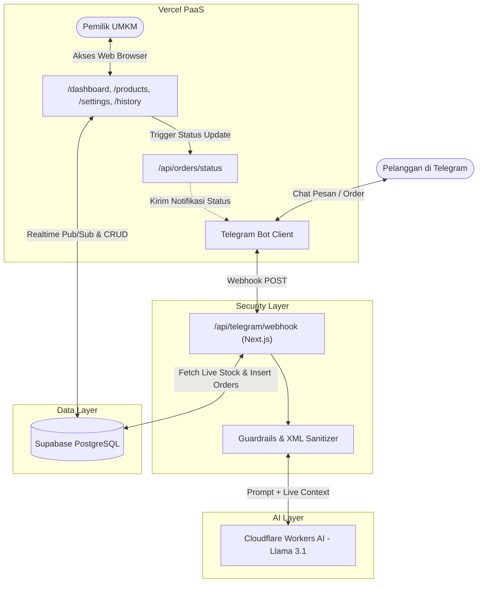

# 🌶️ Agentic AI Pemesanan UMKM Cabai ("Bang Cabai" / Cabai Ibu Umi)

Sistem otomasi layanan pelanggan (*Customer Service*) dan manajemen antrean pemesanan komoditas cabai berbasis **Agentic AI** terintegrasi. Dibangun dengan arsitektur **Unified Monorepo** menggunakan Next.js 14, Supabase (PostgreSQL), Cloudflare Workers AI (Llama 3.1), dan Telegram Bot API.

---

## 🌟 Fitur Utama

### 1. 🤖 Chatbot Telegram Agentic AI ("Bang Cabai")
- **Customer Service 24/7**: Melayani pertanyaan harga cabai harian, stok tersedia, dan pemesanan cabai kustom.
- **Dynamic Context Injection**: Menarik data katalog harga dan stok langsung dari database Supabase secara real-time ke system prompt tanpa halusinasi.
- **Multi-Layer Anti-Prompt Injection Guardrails**:
  - Isolasi input pesan pembeli dalam sandboxing XML (`<user_query>`).
  - Strict Scope Persona: AI menolak dengan tegas perintah di luar urusan cabai (coding, politik, tugas sekolah, jailbreak).
  - Larangan membocorkan prompt sistem internal (*system prompt secrecy*).
- **Deterministic Server-Side Authority**:
  - LLM hanya bertugas mengekstrak identitas varian cabai dan kuantitas (kg) dalam payload tersembunyi `[ORDER_JSON]`.
  - **100% Perhitungan Total Harga & Validasi Stok dihitung di server backend** untuk mencegah manipulasi harga dari pembeli.
- **Dukungan Kustomisasi Fleksibel**:
  - Jasa petik tangkai (bisa diatur gratis atau berbayar per kg).
  - Metode penyerahan: *Ambil Sendiri di Kios* vs *Kurir Mandiri (GoSend/Grab)*.

### 2. 📊 Admin Web Dashboard (Next.js App Router)
- **Kanban Antrean Pesanan Realtime**:
  - Kolom status: *Pesanan Baru (Pending)*, *Dikonfirmasi*, *Ditimbang / Dipetik*, *Siap Ambil / Kirim*, dan *Selesai*.
  - **Audio Chime Synthesizer**: Lonceng notifikasi ding-dong berbunyi otomatis saat ada pesanan baru masuk dari Telegram.
  - **1-Click Status Update & Auto-Notif**: Mengubah status pesanan di dashboard seketika menembakkan notifikasi balasan ke Telegram pembeli.
- **Quick Daily Price & Stock Bulk-Editor**:
  - Form tabel ringkas 1 layar untuk pemilik toko memperbarui harga cabai per kg dan kuota stok setiap pagi sebelum buka kios.
- **Tombol Darurat Buka / Tutup Toko**:
  - Sakelar jeda operasional toko. Jika ditutup sementara (misal: stok habis mendadak / hujan lebat), bot AI otomatis mengumumkan ke pelanggan bahwa pesanan sedang dijeda.
- **Riwayat Transaksi & Laporan Omzet**:
  - Metrik total omzet penjualan, total transaksi selesai, volume total kilogram cabai terjual, serta tombol **Ekspor CSV (Excel)**.

---

## 🏗️ Arsitektur Sistem



---

## 🛠️ Tech Stack

- **Framework Web & API**: [Next.js 14 (App Router)](https://nextjs.org/) + TypeScript
- **Styling & UI**: [Tailwind CSS](https://tailwindcss.com/) + [Lucide Icons](https://lucide.dev/)
- **Database & Realtime**: [Supabase PostgreSQL](https://supabase.com/)
- **LLM AI Provider**: [Cloudflare Workers AI](https://developers.cloudflare.com/workers-ai/) (`@cf/meta/llama-3.1-8b-instruct`)
- **Messaging Interface**: [Telegram Bot API](https://core.telegram.org/bots/api)
- **Deployment Platform**: [Vercel](https://vercel.com/)

---

## ⚙️ Variabel Lingkungan (.env)

Buat file `.env.local` atau masukkan ke konfigurasi **Environment Variables** di Vercel:

```env
# Supabase PostgreSQL
NEXT_PUBLIC_SUPABASE_URL=https://your-project.supabase.co
NEXT_PUBLIC_SUPABASE_ANON_KEY=your_supabase_anon_key
SUPABASE_SERVICE_ROLE_KEY=your_supabase_service_role_secret_key

# Telegram Bot
TELEGRAM_BOT_TOKEN=your_telegram_bot_token
TELEGRAM_WEBHOOK_SECRET=cabai_secret_webhook_token_2026

# Cloudflare Workers AI
CLOUDFLARE_ACCOUNT_ID=your_cloudflare_account_id
CLOUDFLARE_API_TOKEN=your_cloudflare_api_token
CLOUDFLARE_AI_MODEL=@cf/meta/llama-3.1-8b-instruct

# App URL
NEXT_PUBLIC_APP_URL=https://your-domain.vercel.app
```

---

## 🚀 Panduan Setup & Menjalankan Proyek

### 1. Menjalankan di Komputer Lokal

```bash
# Clone repository
git clone https://github.com/Akara5729/Agentic-AI-UMKM-Cabai.git
cd Agentic-AI-UMKM-Cabai

# Install dependensi
npm install

# Jalankan server development
npm run dev
```
Buka browser pada:
- Beranda: `http://localhost:3000`
- Antrean Pesanan: `http://localhost:3000/dashboard`
- Bulk Editor Harga: `http://localhost:3000/products`
- Pengaturan Toko: `http://localhost:3000/settings`
- Rekap Penjualan: `http://localhost:3000/history`

### 2. Setup Database Supabase
1. Buka [Supabase Dashboard](https://supabase.com/dashboard) project Anda.
2. Buka menu **SQL Editor**.
3. Salin isi file [`supabase/schema.sql`](supabase/schema.sql) dan klik **Run**.

### 3. Deploy ke Vercel
1. Login ke [Vercel Dashboard](https://vercel.com).
2. Klik **Add New Project**, pilih repository **`Akara5729/Agentic-AI-UMKM-Cabai`**.
3. Masukkan seluruh *Environment Variables* di atas.
4. Klik **Deploy**.

### 4. Aktivasi Webhook Telegram
Setelah deployment Vercel aktif, aktifkan webhook bot Telegram dengan membuka URL berikut di browser (ganti `<domain-vercel-anda>`):
```text
https://api.telegram.org/bot<TOKEN_BOT_ANDA>/setWebhook?url=https://<domain-vercel-anda>/api/telegram/webhook&secret_token=cabai_secret_webhook_token_2026
```
Bot Telegram Anda kini otomatis terhubung dan aktif melayani pesanan 24/7!
